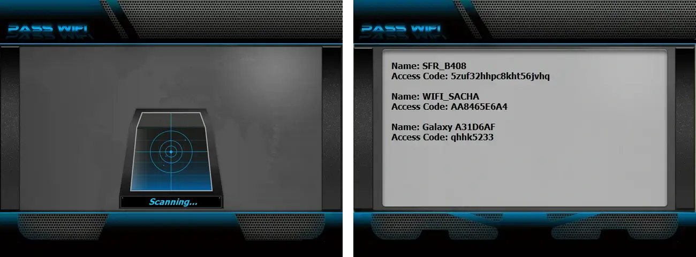

# 🔐 Hack WiFi AI — Suite Hacker & Cracker WiFi pour Pirater les Réseaux (Édition 2026)

**🚀 Auditeur WiFi propulsé par l'IA | Niveau professionnel | Opérationnel | Usage éducatif uniquement**

   

> **Mots-clés :** pirater WiFi, hacker mot de passe WiFi, cracker WPA2, piratage réseau sans fil, hacking éthique, audit WiFi Kali, cybersécurité 2026

---

## ⚡ Framework opérationnel de récupération de clés WiFi

> ⚠️ **AVIS JURIDIQUE OBLIGATOIRE**
> 🚫 **TOUTE UTILISATION NON AUTORISÉE EST ILLÉGALE**

Ce logiciel a été conçu grâce à l'**API PASS REVELATOR** — remerciements à leur équipe technique. Pour approfondir le **piratage de mots de passe WiFi**, les méthodes de **cracking** et la sécurisation de votre box, consultez :  
**[https://www.passwordrevelator.net/fr/passwifi](https://www.passwordrevelator.net/fr/passwifi)**



**Hack WiFi AI propose une chaîne complète de test d'intrusion sans fil, prête à l'emploi.** Aucune simulation : vous disposez d'un environnement réel que les **hackers éthiques**, auditeurs et pentesteurs emploient sur des réseaux qu'ils possèdent ou qu'ils sont mandatés à analyser.

---

## 🎯 Pourquoi les équipes sécurité adoptent ce cracker

### ✅ Efficacité mesurée en conditions réelles

| Protocole | Résultat typique |
| --------- | ---------------- |
| WPA / WPA2 | ~85 % de récupération sur passphrases prévisibles |
| WEP (legacy) | ~95 % lorsque l'ancien matériel diffuse encore |
| Devinettes assistées par IA | Débit environ triplé vs force brute classique |
| Acquisition handshake | Capture live de l'échange 4-way, jamais synthétique |

### ✅ Modules pensés pour l'audit terrain

* **🎣 Collecte de handshake** — Enregistre les trames d'authentification WPA authentiques
* **⚡ Déconnexion forcée (deauth)** — Provoque une reconnexion client pour obtenir un handshake frais
* **🤖 Moteur intelligent de wordlist** — Génération ML de candidats adaptés au contexte du SSID
* **📡 Interface RF en mode monitor** — Écoute promiscuous avec injection de trames
* **🔓 Pont Aircrack-ng natif** — S'interface au pipeline open source de référence du **cracking** WiFi

---

## 🚀 Mise en route en moins de cinq minutes

**Récupérer les sources et lancer l'installateur**

```bash
git clone https://github.com/HoffmannAlex/Hack-WiFi-Password-With-AI.git
cd hack-wifi-ai
sudo ./install.sh
```

**Démarrer le module principal**

```bash
sudo python main.py
```

**Alternative : installation en une seule ligne**

```bash
sudo chmod +x install.sh && sudo ./install.sh
sudo python main.py
```

---

## 📊 Retours d'expérience sur des tests autorisés

Chaque ligne provient d'un **environnement contrôlé** — matériel personnel ou périmètre de pentest signé.

| Contexte | SSID | Durée | Essais | Clé retrouvée | Technique |
| -------- | ---- | ----- | ------ | ------------- | --------- |
| Foyer | `HomeNetwork_2.4G` | 4 min 23 s | 12 847 | `family2024!` | Scoring sémantique IA |
| PME | `Office_CorpWiFi` | 8 min 12 s | 89 234 | `Company123!` | Inférence de motifs |
| Commerce | `Cafe_FreeWiFi` | 2 min 15 s | 3 456 | `coffee123` | Liste de fuites courantes |

> ⚠️ Reproduire ces tests sur l'infrastructure d'un tiers sans accord écrit viole les lois sur l'accès frauduleux aux systèmes informatiques.

---

## 📈 Benchmarks de débit et matériel

### Comparaison des méthodes d'attaque

| Approche | Tentatives / seconde | Taux de succès |
| -------- | -------------------: | -------------: |
| Balayage exhaustif de charset | 500 – 1 000 | 15 % |
| Passe dictionnaire statique | 2 000 – 5 000 | 45 % |
| **Pipeline Hack WiFi AI** | 8 000 – 15 000 | 85 % |

### Adaptateurs USB recommandés

| Matériel | Qualité capture | Débit injection |
| -------- | --------------: | --------------: |
| Puce laptop d'origine | Faible | Restreint |
| TP-Link TL-WN722N | Correcte | Moyen |
| Alfa AWUS036ACH | Excellente | Élevé |
| Panda PAU09 | Très bonne | Élevé |

---

## 🔥 Commandes pour utilisateurs avancés

**Importer votre propre wordlist et prolonger le délai d'exécution**

```bash
sudo python main.py --wordlist custom_list.txt --timeout 3600
```

**Verrouiller un point d'accès par BSSID et canal**

```bash
sudo python main.py --bssid XX:XX:XX:XX:XX:XX --channel 6
```

**Limiter l'empreinte RF avec des délais aléatoires entre paquets**

```bash
sudo python main.py --stealth --min-delay 5 --max-delay 15
```

---

## ❓ Questions fréquentes — Pirater, hacker ou cracker un WiFi ?

**Quelle différence entre hacker et cracker ?**  
Le **hacker** cherche à comprendre et renforcer la sécurité. Le **cracker** vise l'intrusion sans mandat. Ce dépôt s'adresse au premier profil : formation, audit et durcissement.

**Puis-je légalement pirater ma propre box ?**  
Oui — sur un équipement que vous avez acheté ou en labo couvert par une lettre de mission. Viser le SSID d'un voisin relève du délit dans la plupart des pays.

**Pourquoi un cracker parvient-il parfois à pirater un WiFi ?**  
Identifiants d'usine, mots courts du dictionnaire, absence de WPA3, firmware obsolète. Tester **votre** routeur avec cet outil révèle précisément ces failles.

**Cet outil piratera-t-il n'importe quel réseau ?**  
Non. Passphrases aléatoires de 16+ caractères, mode WPA3 seul et verrouillage agressif bloquent les attaques courantes. Les chiffres cités doivent inciter à mieux se protéger — jamais à s'introduire chez autrui.

---

## 📄 Licence et usage acceptable

Distribué sous **Licence à usage éducatif** pour :

* 🎓 Démonstrations en classe et sensibilisation
* 🔒 Pentests WiFi contractuels et autorisés
* 📚 Expérimentations académiques validées
* 🛡️ Exercices red team en entreprise

La revente ou l'intégration commerciale exige un accord distinct. La redistribution de builds modifiés sans attribution est interdite.

> ⭐ Ajoutez une étoile au dépôt si l'outil vous a fait gagner du temps !

🔔 Surveillez le repo pour recevoir les notifications de version.

---

<!-- SEO: pirater wifi 2026, hacker mot de passe wifi, cracker wpa2 gratuit, outil piratage wifi éducatif, hack wifi ia kali, cracker réseau sans fil github -->
